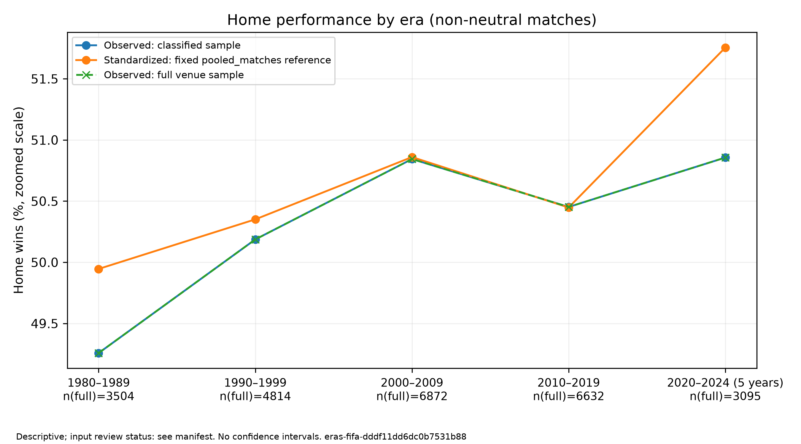
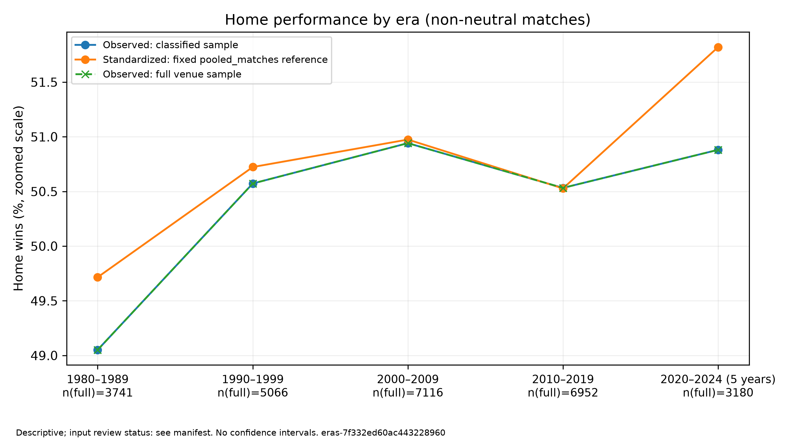

# 国家队主场表现是否随年代变化？

**第四问第二步交接（R20261027-08）：** 本题原样本、胜率、代码和阶段状态未改；[统一目标与模型适配资料](../04_共同可靠性/第二步_目标清单与模型适配资料.md)已完成同版系数/关联/支持核对，并固定主要、辅助、滚动及条件率判断范围。它是后续方法验收的资料，不是本题已经获得正式区间或显著性；原uncertainty仍not_run。

**编号更新（R20261026-01）：** 后续顺序为第二问赛事→第三问地域→第四问前三问统一分析→第五问赛前实力。当前第一问结果不变；历史材料中的旧实力第三问按第五问理解。

## 当前结果：使用人工确认后的24,917场（2026-10-25）

先看[数据再次确认](../00_数据再次确认/README.md)，再看本题。组长已人工核验并决定采用117场及其余有效建议，原26,055场候选现纳入24,917场、排除1,138场、当前范围待定0场。基础清洗没有重写；更新的是研究范围和受影响的统计表图。旧24,279场版与26,055场基线都保留历史，当前展示使用本节。

当前成员版本 `identity-reviewed-29d880765c1623764940`；分析版本 `eras-fifa-dddf11dd6dc0b7531b88`；[运行清单](../../outputs/logs/team_identity/confirmed-eras-20261025T013539824757Z-45eb57c2/run_manifest.json)。用 `scripts/analyze_confirmed_eras.py --config config/confirmed_eras_reviewed.json` 运行，具体操作见[本地与A复现说明](本地运行与复现.md)。

五个时期的结果如下，最后一组只有五年。主胜率分母包含平局，比分含加时、不含点球大战。

- 1980—1989：3,504场；直接49.2580%；统一赛事比例后49.9456%。
- 1990—1999：4,814场；直接50.1870%；统一赛事比例后50.3509%。
- 2000—2009：6,872场；直接50.8440%；统一赛事比例后50.8602%。
- 2010—2019：6,632场；直接50.4524%；统一赛事比例后50.4476%。
- 2020—2024：3,095场；直接50.8562%；统一赛事比例后51.7557%。

直接主胜率约49%—51%，没有单调上升或下降。共同比赛篮子中友谊赛占**38.5199%**，其他非友谊赛事占61.4801%；年度等权参考另存于reference_weights.csv。这个比例是为了按相同构成比较，不是给友谊赛打重要性或可信度分数。

2010年代相对1980年代，直接差为**+1.1944个百分点**，统一赛事构成后为**+0.5019个百分点**；2020—2024相对1980年代，直接差为**+1.5982个百分点**，调整后为**+1.8100个百分点**。两个差值的翻转点分别在友谊赛占比约**31.33%和25.61%**，全范围改变参考配方仍会改变方向。不能据此称结果对任意参考都稳健。



本次仍是描述研究，没有正式区间、显著性结论或控制球队实力后的因果解释。描述方法未改，变更来自成员采纳和由新样本重新计算的参考构成；[与上一会员版对照](../../outputs/logs/team_identity/reviewed-q1-closeout-20261025/compare_previous.json)和[与原26,055场基线对照](../../outputs/tables/eras/eras-fifa-dddf11dd6dc0b7531b88/before_after.csv)分别保存，不把两种对照混为一谈。

## 本次验证、输出与后续

- 全套92项测试通过；从比分和资格重新选择、计数及复算的630项检查通过。另有426项采用范围、原字段保护、第二问输入、权重曲线检查通过。
- 新版运行两遍，19份核心表图逐字节一致；22份登记输出通过指纹验证。原会员版和原26,055场基线继续验证通过。
- [当前统计表和字典](../../outputs/tables/eras/eras-fifa-dddf11dd6dc0b7531b88/)、[三图PNG/SVG](../../outputs/figures/eras/eras-fifa-dddf11dd6dc0b7531b88/)、[完整审查](../../outputs/logs/team_identity/reviewed-q1-closeout-20261025/review.json)与[当前展示数据](../../outputs/logs/team_identity/reviewed-q1-closeout-20261025/display_data.json)均绑定同一版本。展示数据含10个年代×类型单元、4行参考构成、208行配方曲线和6个图文件路径。
- [收尾讲稿和图注](收尾核查与汇报提纲.md)、[论文与汇报材料索引](../../文档/05_团队协作/论文与汇报支撑材料索引.md)已更新。旧版逐年剔除/共同球队结果仍只属于旧版；当前没有重新开展正式可靠性分析。

执行与自检为Codex（AI）；成员范围采纳来自用户本人，A的独立程序复现未冒写为完成。第一问描述可交接；第二问已沿用同一24,917场完成描述，见[第二问结果](../02_赛事类型差异/README.md)。共同可靠性仍未实施，不将两问描述完成写成整个研究已经验收。

**2026-10-25收尾复核：** 当前运行22项登记产物继续验证通过，630项独立复算再次通过，19份核心与此前同版运行一致，见[本次独立审计](../../outputs/logs/research_closeout/20261025/q1_independent_audit.json)。[收尾提纲](收尾核查与汇报提纲.md)补齐直接率、共同赛事配方及参考敏感性的结论审读；[两问衔接讲解](../02_赛事类型差异/收尾核查与汇报提纲.md)和[组员交接要求](../../文档/05_团队协作/分工与交付/03_后续分析与展示.md)已统一。当前状态是“描述阶段完成，正式可靠性与人员复核后置”。

**下面保留原26,055场基线的方法与结果说明。** 它们是再次确认前的版本；旧38.5339%权重、旧图和118项核查不自动适用于新版本。展示制作者必须按[流程版本登记](../pipeline_state.json)选用同一套数据，并标明临时状态。

我们先观察不同年代主队的胜、平、负，再让各年代使用同样的赛事构成，检查差异如何变化。研究对象是现有档案中的国际男子国家队非中立场比赛；主胜率包含平局分母，比分含加时、不含点球大战。

## 旧基线进度与方法背景

2026-10-24 已补齐[两题共用的前置约定 v1](最终审查与后续衔接.md)：样本、结果、比较方向、共同参考、逐场接口和推断关卡已有具体工作口径。本题暂时收尾为“描述部分完成，正式推断待两题统一处理”，可进入第二题详细设计；A/B 验收、事实冻结与方法验证仍未完成。第二题规则是看过既有分组结果后记录的探索性延续。

截至 2026-10-23，年代分析第一版已实现并运行：入口为 src/analyze_eras.py，内部六模块，支持样本诊断、描述、赛事构成标准化和点估计稳健性。输入为 prep-3fab808178cf8ad71d88，人工核验待完成、尚未冻结；协议标为 draft，区间与显著性检验未实施。

2026-10-24 完成字段/格式与核心计算的独立收尾审计，118 项检查通过；[核查报告](../../outputs/logs/eras/closeout-20261024/output_audit.json)和[展示提纲](收尾核查与汇报提纲.md)已保存。独立脚本复算不代表另一位组员已复核，人工验收状态仍为 pending。

本版将 1980—2024、五个年代和两个对比事先写入 config/eras.json，作为探索性配置；确认性研究仍需组内确认。成对稳健推断是待验证候选，没有用默认独立样本区间替代。

## 我们怎么研究

1. 事先记录样本、问题和比较规则，不预设变化方向。
2. 直接统计各年代主胜率、平局率、客胜率及净胜球。
3. 分别查看友谊赛与非友谊赛事，再用共同赛事比例汇总各年代。
4. 检查球队重复参赛、主客交换、赛程集中与共同时间环境，验收适当的不确定性方法。
5. 改变合理参考口径、去掉个别年份、比较共同球队，检查结论依赖什么。

友谊赛权重可以理解为“共同比赛篮子里友谊赛占多少”，并非它的重要程度。本版合并样本配方为友谊赛 38.5339%；每年等权参考为 40.4346%，并检查整个权重范围。这里借用直接标准化的原理，不声称 CDC 为足球指定了最优权重。

这些比较描述观测赛程中的关联。统一赛事构成没有控制全部实力、地区与对手选择，不直接证明主场因果优势改变；赛前Elo实力调整属于第五问。

## 去哪里看详细内容

- [最终审查与后续衔接](最终审查与后续衔接.md)：按项目进度、理论、后续研究与课程汇报核对缺口；区分描述交接与完整第一题验收。
- [五步规划与逐项处理判断](../../文档/01_项目方案/第一题_年代变化研究五步规划.md)：为什么这样研究、哪些问题必须处理。
- [本阶段 Python 脚本设计](脚本设计.md)：一个入口与内部模块、清洗接口、文件格式、错误与验收。
- [本地运行与 A 的复现说明](本地运行与复现.md)：PyCharm 配置、命令、实际参考数量和交付要求。
- [收尾核查与汇报提纲](收尾核查与汇报提纲.md)：字段验收、工作流程、可展示发现和素材缺口。
- [课程要求与 HTML 方案](../../文档/05_团队协作/汇报要求与HTML方案.md)：截图证据、10 分钟要求和载体确认边界。
- [方法文献目录](../../参考资料/方法文献/README.md)：来源、原文版本、用途及本地保存情况。
- [研究日志与决策记录](../../文档/01_项目方案/研究日志与决策记录.md)：思路如何变化、真实操作、失败及复核。
- [团队分工](../../文档/05_团队协作/分工与交付/00_先看这里.md)：A 复核，B 定向取证，组长决定采用版本。

## 原26,055场基线的复现与成果状态

在仓库根目录运行（先按上手指南配置自己的环境）：

```powershell
.\.venv\Scripts\python.exe -m src.analyze_eras --prep-config config.json --analysis-config config/eras.json --stage all
```

实际参考 analysis_id 为 **eras-7f332ed60ac443228960**。输入清洗表 48,102 场，经日期和非中立筛选后 26,055 场，赛事分类已知也是 26,055 场。各年代原始主胜率约为 49.05%、50.57%、50.94%、50.53%、50.88%，不呈单调变化，不能解释为因果优势或统计显著。

共同配方下，2010—2019 相对 1980—1989 的描述差异为 +0.8122 个百分点，2020—2024 相对 1980—1989 为 +2.1046 个百分点。后者只有五年，不能与完整十年不加说明地并列解释。

在整个参考占比 [0,1] 范围内，两个对比的点估计都会翻转，翻转点分别约为友谊赛占比 26.63% 与 24.12%；因此不能说结论方向与参考配方无关。这是代数敏感性，不是显著性结果，详见 weight_sensitivity.csv。

- [统计表和字段字典](../../outputs/tables/eras/eras-7f332ed60ac443228960/)
- [参考运行清单](../../outputs/logs/eras/eras-20261023T153613611524Z-06eea9e4/run_manifest.json)与[中文小结](../../outputs/logs/eras/eras-20261023T153613611524Z-06eea9e4/summary.md)
- [样本/数值自动对账](../../outputs/logs/eras/eras-20261023T153613611524Z-06eea9e4/checks.json)：通过；全仓库测试 48 项通过，组员复核尚未完成。



共有 12 张 CSV、逐列字典、3 张图的 PNG/SVG 与每次运行的日志。逐年剔除、共同球队和替代参考的结果见 sensitivity_results.csv；它们不证明相关性已处理。以上表图链接专指原26,055场基线；当前有条件版请使用页首及数据再次确认入口，不能混用。更改数据、配置或分析源码会产生新身份，更新本页前须核对来源与检查结果。

本页作为 GitHub 的阶段展示入口；方法理由保留在五步规划，历史决定保留在研究日志。任何结论更新都必须能追到表、配置、输入版本、代码版本与复核状态。
