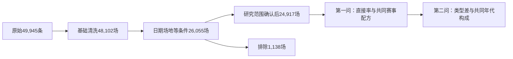
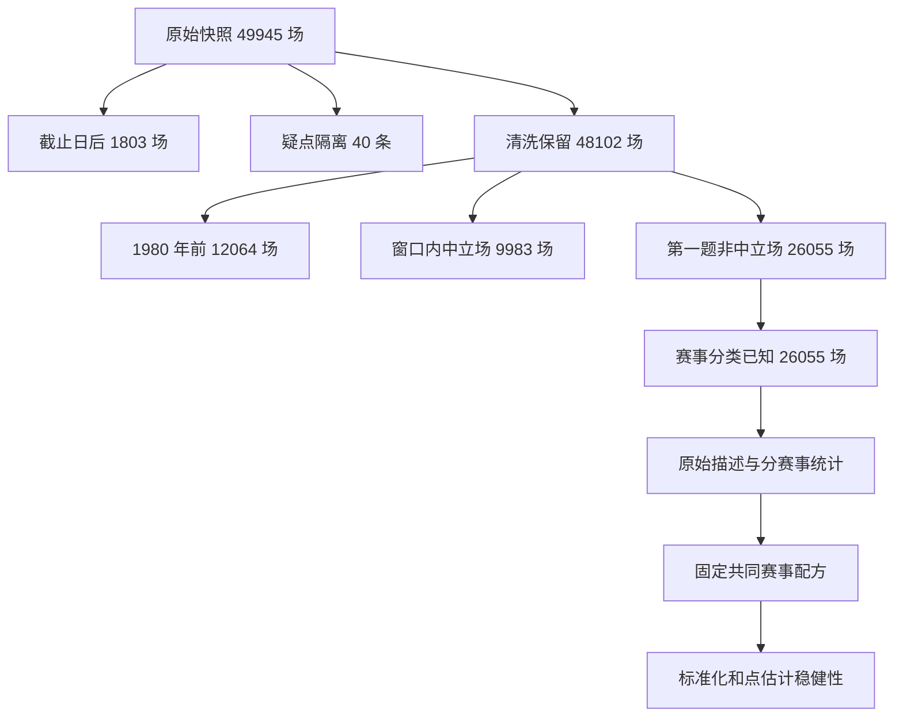

# 第一问描述阶段：收尾核查与汇报提纲

**2026-10-26编号说明：** 当前路线为第一问年代、第二问赛事、第三问地域、第四问前三问统一分析、第五问赛前实力。本文历史段落中的“第三问/第三题（实力）”对应第五问，“两问共同可靠性”对应第四问；历史结果与当时审查不重写。当前安排及未编号备选以[研究路线](../README.md)为准。

## 当前四屏讲稿（24,917场版）

取数仅用[当前展示数据](../../outputs/logs/team_identity/reviewed-q1-closeout-20261025/display_data.json)；原24,279场和26,055场的数字只留在历史证据里。第一问约2分30秒，前面的数据说明约30—60秒，计入全组10分钟。

**第一屏，问题与样本，约25秒。** “我们观察1980—2024年非中立场比赛，比较不同年代主队表现。先清洗日期、比分和疑点，再确认研究范围，最后纳入24,917场。最后一组只有五年。主胜率把平局也放在分母里，比分不含点球大战。”

**第二屏，直接结果，约30秒。** “五个时期的主胜率依次约49.26%、50.19%、50.84%、50.45%、50.86%，没有单调升降。图的纵轴放大了，实际变化只有百分点量级。”使用era_results.png。两条直接率线重合，是两种样本视图在当前数据中恰好相同，不是两份独立证据。

**第三屏，共同比赛篮子，约50秒。** “不同年代友谊赛比例不同。我们把每个年代都按友谊赛38.5199%、其他赛事61.4801%的同一配方计算。这个比例用来公平比较，不是重要性评分。2010年代相对1980年代，直接高1.1944个百分点，调整后高0.5019；最近五年直接高1.5982，调整后高1.8100。”用赛事构成图和调整线解释。

**第四屏，边界和下一问，约35秒。** “改变共同配方也会改变年代比较；两个差值在友谊赛占比约31.33%和25.61%处翻转。目前没有正式区间，也没有控制球队实力，不能讲成主场优势显著增强。下一问将直接比较两类比赛，并统一它们的年代构成。”用weight_sensitivity.png，主参考竖线为38.5199%。

图注：

- 年代结果：“24,917场工作样本；直接率与共同赛事配方调整率，无置信区间，纵轴放大，末组五年。”
- 赛事构成：“同一工作样本中两类比赛的场数比例；其他非友谊赛事并非仅顶级大赛。”
- 权重曲线：“改变参考篮子中友谊赛占比，观察预定年代差如何变化；这是描述曲线，非预测或置信带。”



展示主线交代统一样本即可，不展开117场或逐国资料细节；内部采纳记录保留以便追溯。HTML素材、讲稿、图注和论文材料索引均已有；HTML成品、老师对载体的确认、组员独立复现与现场排练尚未完成。正式区间与共同可靠性继续后置。

## 本次收尾证据

[独立复算630项](../../outputs/logs/team_identity/reviewed-q1-closeout-20261025/independent_audit.json)、[范围和曲线426项](../../outputs/logs/team_identity/reviewed-q1-closeout-20261025/population_and_curve_checks.json)、[92项测试](../../outputs/logs/team_identity/reviewed-q1-closeout-20261025/pytest.txt)、[与上一会员版对照](../../outputs/logs/team_identity/reviewed-q1-closeout-20261025/compare_previous.json)、[当前版本登记](../pipeline_state.json)、[材料索引](../../文档/05_团队协作/论文与汇报支撑材料索引.md)。19份核心在两次新版运行中一致，三张PNG已目视检查，旧版本验证通过。

## 当前版结论审读补充（2026-10-25）

本轮确认第一问描述阶段已具备完整交接材料；当前运行22项登记产物继续通过验证，[再次独立复算](../../outputs/logs/research_closeout/20261025/q1_independent_audit.json)630项通过，19份核心与既有同版运行一致。没有重跑主统计或新可靠性实验，A/B仍未实际复现。

**直接结果怎么确认：** 五个年代的直接主胜率按各自“主胜场数÷全部比赛场数”得到，平局保留在分母。比率依次49.2580%、50.1870%、50.8440%、50.4524%、50.8562%，2010年代低于2000年代，因此只能说有波动，不能说单调上升。

**共同赛事配方怎么确认：** 友谊赛9,598场÷24,917场＝38.5198860216%，其他赛事占61.4801139784%。每个年代都按这同一配方加权两类组内率。例如1980年代按38.5198860216%×(747/1,656)＋61.4801139784%×(979/1,848)，得到49.9456%。计算使用完整精度，最后才舍入。分别取后期调整率减1980年代调整率，两项主比较得到+0.5019、+1.8100个百分点；直接率的对应差为+1.1944、+1.5982个百分点。

**参考选择有什么影响：** 当前权重曲线及翻转点已有核查证据；两个差值会随共同配方改变方向。它说明“这个比较依赖什么配方”，不是证明历史变化不可靠，也不代替置信区间。新版逐年剔除、共同球队以及正式联合推断仍在[共同任务](../../文档/05_团队协作/分工与交付/04_两题共同可靠性与敏感性.md)处理。

两问怎样接起来讲，见[第二问收尾提纲的两问衔接部分](../02_赛事类型差异/收尾核查与汇报提纲.md)。两问复用了同一批比赛和十个分组单元，不能当作两份独立验证。

## 原26,055场基线的历史收尾审计（以下均为旧版）

以下118项及旧版敏感性不充当当前版证据。

## 1. 输出核查结论

检查对象为 analysis_id **eras-7f332ed60ac443228960**，输入 prep-3fab808178cf8ad71d88；核对仓库新增的同版运行 `eras-20261024T013933600718Z-425e4920`。它在本轮开始前已存在，执行者尚未由记录确认，不能据此补写“A 已复现”或“用户已验收”。

- --verify-run 通过：24 项运行清单所登记的输出，以及输入和相关源码指纹匹配。
- 新增独立核查脚本不调用年代分析的统计函数，而是从清洗比分重算主要数字；[118 项核查报告](../../outputs/logs/eras/closeout-20261024/output_audit.json)为 passed=true。
- 12 张 CSV 的字段顺序、主键、稳定排序、UTF-8 BOM/LF、整数/布尔/10 位小数、数组和缺失序列化通过；概率与百分点单位、空区间及 not_run 状态通过。
- 原始胜平负、逐年与分赛事计数、平均净胜球、两套参考权重、标准化、年代对比、权重翻转点及 39 项敏感性结果的独立复算通过。赛程诊断表本轮核查字段与数值格式，不将它解释为残差依赖已得到验证。
- 这些检查验证结果符合代码契约与选定口径，不替代逐场外站事实核对或统计推断适配。

重做本轮审计：

```powershell
.\.venv\Scripts\python.exe scripts/audit_eras_outputs.py
.\.venv\Scripts\python.exe scripts/prepare_era_display_data.py
```

这两条用于当前指定的完整分析版本；审计脚本不是任意未来方法的通用验收器。它们保存收尾报告和展示数据，不覆盖原始数据或统计产物。当前审计默认写同一份当日核查报告，重跑会更新审计时间；若需要保留另一轮证据，使用 --output 指定新的项目内路径。数据导出前会再次检查来源哈希。

### 文件数量为什么合理

era_summary 有 10 行，因为有全体场地样本、赛事已知样本两个视图，各 5 个年代；本次两者恰好都是 26,055 场，sample_id 相同是预期行为，sample_name 区分视图。year_summary 同理有 90 行，即 2×45 年。

reference_weights 有 4 行，即两套参考各两类赛事；era_estimates 有 20 行，即 5 年代×2 参考×原始/调整两种指标；era_contrasts 有 12 行，即 2 对比×2 参考×3 种差值；208 行权重曲线包含固定网格、参考值和翻转点；39 行稳健性由 35 个受影响的剔年对比、2 个共同球队对比、2 个替代参考对比组成。它们不是重复比赛记录。

### 本轮发现的说明问题

原始 README 仍写 49,459 场、截至 2024，这是来源说明的旧文字；实际快照为 49,945 场，延伸到 2026，主清洗按截至 2024-12-31 排除 1,803 场。汇报使用 CSV/manifest 的实测数，不修改原始 README 来伪装上游文档已更新。

## 2. 实际结果可以怎样讲

- 1980—2024 的基础非中立场样本为 26,055 场，友谊赛 10,040 场、其他非友谊赛事 16,015 场；赛事分类缺失为零。
- 主参考友谊赛占比为 38.5339%，年度等权参考为 40.4346%；两者是不同共同赛程，不是两个训练重要性系数。
- 五个年代原始主胜率约为 49.05%、50.57%、50.94%、50.53%、50.88%，不呈单调变化。
- 主参考下，2010—2019 相对 1980—1989 的调整后差异为 +0.8122 个百分点；2020—2024 相对 1980—1989 为 +2.1046 个百分点。
- 两个对比随共同参考权重变化都会翻转，翻转点约 26.63% 与 24.12%；不能说“选哪个配方，方向都一样”。
- 尚未计算置信区间，没有控制全部实力或地区，不使用“显著上升”“证明主场因果效应”等表述。2020—2024 是五年，不是完整十年。

主要证据：[原始统计](../../outputs/tables/eras/eras-7f332ed60ac443228960/era_summary.csv)、[参考](../../outputs/tables/eras/eras-7f332ed60ac443228960/reference_weights.csv)、[差值](../../outputs/tables/eras/eras-7f332ed60ac443228960/era_contrasts.csv)、[权重敏感性](../../outputs/tables/eras/eras-7f332ed60ac443228960/weight_sensitivity.csv)。

## 3. 工作流程怎样展示

下面可以直接用于 GitHub 的流程说明，后续按同一数字制作 HTML/SVG/PPT。上游清洗和下游研究取样分两层，不能在 26,055 场中重复扣除隔离记录。



流程证据为 sample_flow.csv 与上游清洗 manifest。原始文件登记、逐行追踪和修正记录是为了可靠复现，口头讲解用“保留原文件、记录每场去向、重跑核对”即可，不把哈希细节塞满主展示页。

## 4. 第一部分约 2 分 30 秒的展示结构（建议）

全组总时长是 10 分钟。本节时长是小组建议，不是老师规定，也不代表后续两个问题已完成。

1. **问题与样本，约 40 秒。** 问“主队表现是否随年代改变”；用上面的取样流程，讲清 49,945、48,102、26,055 的关系，比分和平局口径点到为止。数据准备全流程可作为附录，主页面不逐条讲全部警告。
2. **先看实际变化，约 30 秒。** 展示年代图，强调原始主胜率在约 49%—51% 之间波动，不是单调变化；图的纵轴是放大刻度，2020—2024 为五年。
3. **为何统一配方，约 45 秒。** 展示赛事构成与原始/调整切换；用“每个年代都装成同一比例的两类比赛”解释 38.5339%。若使用 58/57 与 55/60 的例子，必须注明是假设教学例子，不能混入实际结果表。
4. **选择有多大影响，约 35 秒。** 展示权重敏感性，指出翻转点；结束于“构成与参考选择值得讨论，实力和不确定性还要继续研究”，自然衔接后续两个方向。

主线不展示 12 张完整表或所有函数，问答附录准备独立复算、字段字典和限制。当前标准化方法是已有原理的应用；本组贡献可准确写为明确比较目标、区分实际/共同构成、检验参考敏感性、实现可追踪复现，不宣称发明新估计器。

## 5. 已有与需要补充的素材

已有：取样流程数字、三张 PNG/SVG、标准化教学例子、统计与权重表、逐行成员表、复现清单、方法文献及研究日志。新增[离线展示数据包](../../outputs/presentation/eras/eras-7f332ed60ac443228960/presentation_data.json)，来源及指纹齐全，便于后续页面或幻灯片统一取数。

需要补充：一份简短口头讲稿和图注；组员实际复核与贡献；一个经 B 查证并由组长裁定的处理案例；全组排练时间、问答以及投影/离线测试。B 尚未提交核验时，数据处理案例只能标“待核验”，不能写成已证实的错误。

若做 HTML，最有价值的交互是原始/统一配方切换和共同友谊赛占比滑块；默认回到 38.5339%，两种赛事原始表现与单位保持可见。滑块表示假想参考构成，不代表采集新比赛、重训模型或检验统计显著。所有控制应有明确标签、可重置；为读图保留静态默认画面。

展示数据包并非完整网页，不含浏览器兼容性验收；未来离线单文件页面可将 JSON 内嵌，而不是在 file:// 下依赖 fetch 读取文件或联网 CDN。嵌套原表保留 CSV 字符串，空数字必须转换为 null，不能通过 Number('') 变成零。页面附来源、版本、限制，保留 PDF 等静态备份。

## 6. 文档与保存状态

详细方法留在五步规划，实际状态与成果入口留在阶段 README，代码/格式契约留在脚本设计，操作留在本地复现说明，历史更正追加研究日志。本文件集中收尾结论和展示结构，避免再维护一套不同数字。

本轮开始时，本地 HEAD 为 d349052，既有源码、阶段 README、13 个表/字典及 6 张图文件已纳入 Git。不能据此声称远端已经同步，也不能将旧提交当成本轮新增收尾文件的提交。本轮新增核查、展示资料及文档已写入工作区，尚未代为提交或推送。

课程硬性要求、HTML 许可边界和组内任务见[汇报要求与 HTML 方案](../../文档/05_团队协作/汇报要求与HTML方案.md)。目前适合准备内容与证据，HTML 载体先请老师确认，再将最终三项研究组织成完整 10 分钟展示。
