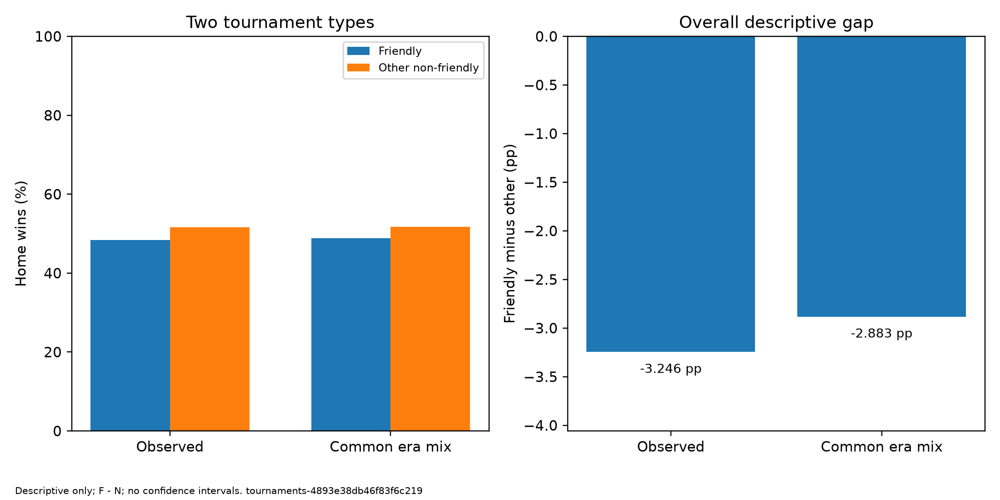
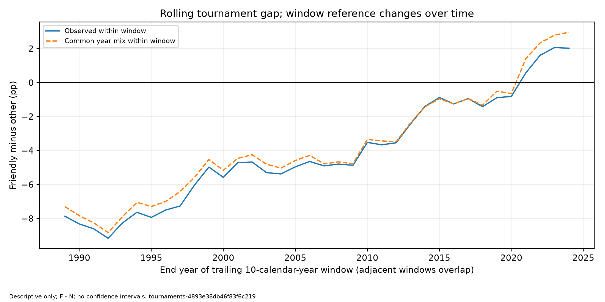

# 第二问：友谊赛与其他非友谊赛事的主胜率有何不同？

**当前共同核验结论（R20261028-05）：** 原描述值不变；全期、近期和36窗模型条件范围均跨零。删年对照保留全期负/近期正的描述方向，仍不支持稳定反转结论。 [第四问实际结果](../04_共同可靠性/第四步_运行结果与复现.md)是当前解释与复现入口；后文not_run等保留原独立描述阶段状态，不能覆盖本条。


**共同可靠性最新交接（R20261028-03）：** [第四问联合模型](../04_共同可靠性/第三步_联合模型选择与第四步交接.md)已完成均值/慢波动联合估计及指定范围验收，选定下一步主方法；本题原样本与表图不变，真实模型条件区间、专属可靠性/新敏感性尚未运行。下方R20261028-02为上一轮历史交接，不能覆盖本条。


**上一轮共同可靠性交接（R20261028-02）：** [第四问双路线迭代](../04_共同可靠性/第三步_双路线演算与迭代记录.md)已开展实际模拟并发现限制，未批准本题正式区间/显著性。本题原描述表图及样本不变；下文旧日期的“模拟未运行”等是当时状态，不能代替当前交接。

**第四问第二步交接（R20261027-08）：** 本题原样本、胜率、代码和阶段状态未改；[统一目标与模型适配资料](../04_共同可靠性/第二步_目标清单与模型适配资料.md)已完成同版系数/关联/支持核对，并固定主要、辅助、滚动及条件率判断范围。它是后续方法验收的资料，不是本题已经获得正式区间或显著性；原uncertainty仍not_run。

**当前编号（2026-10-26）：** 第一问年代、第二问赛事、第三问地域、第四问前三问统一分析、第五问赛前实力。下文方法部分的后续指向按此编号理解；旧运行、日志和图表不改写。完整路线与未编号备选见[研究入口](../README.md)。

**阶段收尾确认（2026-10-25，R20261025-20）：** 用户明确暂缓HTML、论文相关工作和组员独立核验。在此边界下，本题独立描述工作结束，转入后续研究；正式可靠性仍由共同任务处理。已有结果与材料继续保留，暂缓事项未改标为完成，最终课程交付也未完成。地域已按R20261026-01确认为第三问，第四问统一分析前三问，第五问研究赛前实力；第三至第五问尚无运行结果。

## 当前结果：描述、年代标准化与滚动计算已完成（2026-10-25）

本题使用与第一问完全相同的24,917个比赛ID、成员版本identity-reviewed-29d880765c1623764940及1980—2024范围。117场按组长人工采纳使用，当前候选待定0。主比分含加时不含点球，平局保留在主胜率分母；差值固定为“友谊赛减其他非友谊赛事”，单位为百分点。

- 实际赛程：友谊赛9,598场、主胜4,645场，主胜率**48.3955%**；其他非友谊赛事15,319场、主胜7,911场，主胜率**51.6418%**。直接类型差**−3.2463个百分点**。
- 采用共同年代比例：两类调整率分别为**48.8621%和51.7452%**，类型差为**−2.8831个百分点**。差距比原始比较缩小约0.3632个百分点，说明结果对这项年代构成调整有反应；不能称其为年代的因果贡献。
- 各年代差值如下，不能用一个全时期平均数掩盖方向变化：

- 1980—1989：-7.8675个百分点；友谊赛1,656场，其他赛事1,848场。
- 1990—1999：-4.9744个百分点；友谊赛2,013场，其他赛事2,801场。
- 2000—2009：-4.8716个百分点；友谊赛2,670场，其他赛事4,202场。
- 2010—2019：-0.8894个百分点；友谊赛2,519场，其他赛事4,113场。
- 2020—2024（五年）：+6.1563个百分点；友谊赛740场，其他赛事2,355场。

36个完整十年窗口也已生成。1980—1989窗原始差−7.8675、统一窗内逐年构成后−7.3037；2015—2024窗分别+2.0191、+2.9619个百分点。原始与调整曲线最后四窗均为正，但共享大量比赛，不能当四次独立验证。窗口结果不等于末年的单年表现；2015—2024十年与2020—2024五年的结果也不应混称同一时期。





## 已实现的程序与证据

**全面收尾检查（2026-10-25）：** [审查记录](../../outputs/logs/research_closeout/20261025/q2_scope_review.json)确认描述计算、同版表图、展示素材、按既定范围的论文材料索引和后续接口齐备。最终HTML尚无入口，完整课程报告、A/B实际验收和现场排练未完成，不能把素材齐备写成最终交付全部结束。详见[收尾提纲第7节](收尾核查与汇报提纲.md#7-全面检查后的完成边界2026-10-25)。正式可靠性仍按用户要求后置，不阻塞本题描述收尾。

**后三项收尾材料（2026-10-25）：** 第一问描述已再次核查通过；两问衔接说明与20秒讲稿已加入[收尾提纲](收尾核查与汇报提纲.md)，[共同任务](../../文档/05_团队协作/分工与交付/04_两题共同可靠性与敏感性.md)登记后续五类问题，[团队交接](../../文档/05_团队协作/分工与交付/03_后续分析与展示.md)给出A/B实际操作、讲解核对题、交付和验收要求。[联合核对](../../outputs/logs/research_closeout/20261025/review.json)49项通过：两问精确同一24,917个比赛ID、十单元计数相同，展示来源165个指纹匹配。材料已准备不代表A/B已经执行或组内已排练；共同可靠性仍未运行。

**结论审读补充（2026-10-25）：** 全时期直接差与共同年代差已从整数场次重新核算，31项检查通过，逐年代场数、共同配方及加权过程见[收尾材料第5节](收尾核查与汇报提纲.md#5-结论审读前两项已核算近期变化的稳定性后置)和[审读证据](../../outputs/logs/tournaments/conclusion-review-20261025/review.json)。近期正差的稳定性、敏感性与正式区间按组长确认留到两问共同阶段；本次没有修改样本、原运行表图或开展新推断，A/B复核仍未完成。

主入口为[scripts/analyze_tournaments.py](../../scripts/analyze_tournaments.py)，六模块及[独立复算入口](../../scripts/audit_tournaments.py)均已实现；协议和字段见[脚本设计](脚本设计.md)。[本次运行清单](../../outputs/logs/tournaments/tournaments-20261025T022318417600Z-78d8e623/run_manifest.json)绑定所有输入/依赖源码；[统计表与字典](../../outputs/tables/tournaments/tournaments-4893e38db46f83f6c219/)和[三图PNG/SVG](../../outputs/figures/tournaments/tournaments-4893e38db46f83f6c219/)均为 `tournaments-4893e38db46f83f6c219`。

- 2,718项内存计算检查通过，第一问十单元计数与本题一致；本次issues为0。
- 全仓库106项测试通过，含本题14项实例/错误/边界测试；[实际测试输出](../../outputs/logs/tournaments/closeout-20261025/pytest.txt)。
- [独立核查](../../outputs/logs/tournaments/closeout-20261025/independent_audit.json)3,630项通过，重新选样并从整数比分复算；两次真实运行17份核心表图逐字节一致。
- 九张CSV共含102行分组计数、365行参考、158行两类率、79行类型差、36窗和72行窗口计数；逐场追踪48,102行，窗口成员204,501行。后者是比赛—窗口关系数量，**不等于独立比赛数**。
- [展示取数](../../outputs/logs/tournaments/tournaments-20261025T022318417600Z-78d8e623/display_data.json)含两类率、差、权重、窗口、来源指纹和局限；[本地运行与A复现](本地运行与复现.md)、[收尾与汇报讲稿](收尾核查与汇报提纲.md)、[材料索引](../../文档/05_团队协作/论文与汇报支撑材料索引.md)已同步。

执行与自检为Codex（AI）；A独立复现和B资料小样未冒写为完成。程序验证不替代统计方法验收。第一问与原始/清洗数据未改；正式区间、模拟、逐年剔除、共同球队、替代参考/起点/窗口尚未开展，待第三问地域描述完成后进入[第四问：前三问统一分析](../../文档/05_团队协作/分工与交付/04_两题共同可靠性与敏感性.md)的方法设计。

以下保留研究逻辑及实施前准备理由；实际运行状态统一以文首及pipeline登记为准。

## 局限及其对应的解释边界（2026-10-25，实施前固定）

- **档案范围与记录质量：** 结果描述这份档案、当前筛选规则下的比赛，不等于全部国际比赛的无偏抽样。当前成员范围已由组长采纳；比分/场地等如发现实质错误仍须受控修订。本轮不重新要求117场资料，也不以统计区间覆盖记录错误。
- **球队实力与选赛差异：** 两类比赛的对手、地区、参赛者和比赛安排可能不同。调整后仍有差别不能解释为友谊赛“导致”主胜率改变；实力分析留到第五问，因果识别仍需额外依据。
- **时间调整的粒度：** 主结果统一五年代比例，并未统一年代内部每一年；滚动补充统一窗内年份比例，也没有统一球队。两种调整分开标识，不写“已排除所有时间因素”。
- **参考与分组：** 共同年代比例代表当前档案构成，不是唯一正确或最优的足球配方。1980起点、十年宽度是工作选择；末组仅五年。non_friendly内部还有不同赛事，不简单等同顶级大赛。替代参考、起点、窗口及赛事细分检查后置。
- **滚动曲线：** 相邻窗口共享九年，单一事件可能影响连续多个点，短期突变可能被平均稀释；不能把平滑、连续同向或36点当作独立验证。每个窗口的参赛构成和逐年参考也会变，曲线不是单年效应或固定人群的纯时间效应。
- **两问信息重叠：** 两问主结果都使用同一十单元表；第二问帮助解释第一问的构成敏感性，不是独立验证。
- **不确定性尚未验收：** 共享球队、主客交换、非共享球队的共同时间环境和窗口重叠不能由总场数多自动解决。成对稳健/平稳测量文献仍是有条件参考；本轮不计算正式标准误、置信区间或显著性，不作预测。理论适配、模拟、联合区间和敏感性由两问共同任务处理。

这些局限不妨碍准确计算当前样本的比例和加权指标。程序现在必须处理的是样本精确对应、正确分母、共同权重、缺组、窗口成员及独立复算；不能把事实错误或计算失败仅写成局限后继续发布。

## 一、我们究竟想回答什么

主问题是：**在国际男子国家队的非中立场比赛中，友谊赛与其他非友谊赛事的主胜率相差多少？让两类比赛采用相同的年代构成后，还相差多少？**

随后回答两个问题：这种差别是否在各年代都存在？如果每次观察连续十年、每次向后移动一年，差别的长期走势是什么样？

本题先研究表现差异，不直接认定赛事类型造成了差异。两类比赛的球队、对手实力、地区和选赛方式都可能不同。主胜率也不等于主场带来的因果收益；实力问题留给第五问进一步讨论。

## 二、研究哪些比赛，怎样定义结果

沿用第一问的清洗数据，时间为 1980-01-01 至 2024-12-31，只取场地判定可用、确认为非中立场且赛事分类可用的国际男子国家队比赛。旧基线符合这些原条件的样本为26,055场；当前还须叠加人工采纳后的会员覆盖包，纳入24,917场。样本以实际清单为准，第二问已按此范围实际运行。

比赛分为友谊赛和其他非友谊赛事两类。后一类包括多种杯赛、预选赛等，不能简写成“顶级大赛”。中立场排除后，本题也不能代表所有世界杯、洲际杯或其他赛事的全部比赛。

主胜率等于主胜场数除以全部合格比赛场数，平局包含在分母。比分包含加时、不包含点球大战；加时后打平而主队点球获胜，仍按平局计。净胜球暂不增加为本题研究任务。

未知分类不猜测补齐，疑点继续按已有政策隔离；分别报告排除数量和原因。当前两题共用24,917场工作样本，以后版本变化时仍要重新检查，不能将这个数或旧26,055当成固定常量写死在统计程序。

### 1. 为什么从1980年开始

1980年是当前研究范围的工作选择，不是已证明的数据质量或足球制度分界。选择这一范围，是为了三问采用一致范围、控制课程项目规模，并形成四个完整十年及一个明确的五年尾段。不把“整十年好分组”包装成最优统计起点。

现有清洗表仍保留1980年前12,064场，其中1970年代4,116场，不能笼统说早期数据没有用或不够多。字段有值同样不证明记录全部准确。更早数据未删除，只是不进入本轮主描述。

报告按研究范围解释起点，并将1970或1990起点列入后续敏感性设计。不同起点改变了目标时期，不能将结果变化自动判定为原方案错误；这些检查不在本轮执行。

### 2. 大赛、东道主与实际场地

不按“大赛”名称整批排除比赛。东道主在本国实际场地参赛、且场地规则核验一致时，可以作为非中立场；两个外来球队在举办国交手则是中立场。官方赛程排在前面，不代表实际拥有本地主场。联合举办时，在另一个协办国参赛也不自动算本国主场。

现有数据已经作了这种区分：1998年法国—巴西、2014年巴西—德国标非中立；2014年德国—阿根廷、2022年阿根廷—法国标中立。当前清洗表1980—2024的世界杯比赛中，64场标非中立，592场标中立。它们是本地标记核对，不代表完成全部官方逐场事实核验。

沿用已有 neutral 标记作当前可复现的输入依据，核查时结合具体举办地、参赛实体和来源证据。球队名与举办国可能因历史名称、地区代表队或其他原因不一致，不能按字符串相等自动重写主客身份。若发现真实主客角色颠倒，必须同时处理双方身份、比分和相关特征，不能只翻转一个布尔标记。

大赛东道主环境与日常主客场不必完全相同。为未来的排除检查保留精确赛事名、年份、举办地和双方身份；正式建立“大赛决赛圈东道主”标记前，须列明纳入的赛事届次、联合主办和跨国比赛规则及证据。不能仅凭非友谊赛或国家名相等就声称已有该标记。这项敏感性可后置，不阻塞按现有场地口径做描述。

### 3. 本轮新发现的样本边界

准备审查发现一条字面筛查候选：2006-12-09 的 Silesia—Poland，举办国 Poland，原表为非中立场。它不能仅凭名称关系判错，也不应自动排除；但表明本题不能默认为“参赛者必然各对应一个不同的主权国家”。上游档案范围也不等于仅限 FIFA 成员。

该候选的球队身份、双方所在地理范围和非中立含义需要核验。研究是沿用上游的男子成年代表队范围，还是另收紧为某种国家队/地区队范围，应由组长明确；若收紧，需有一致的身份标准，检查所有受影响记录，并重跑两题，不能只删这一场。

当前处置已落实：2006-12-09的Silesia—Poland按用户采纳的非会员范围建议排除，eligible_under_provisional_policy=false；不在当前24,917场内，也不再列为本次研究待定比赛。名称不等于主权国家名，历史/地区标签应依研究范围记录去向，不能只按字符串猜测。

候选和来源记录已保存到[输入范围核查报告](../../outputs/logs/tournament_planning/planning-review-20261024/input_scope_audit.json)，报告保留当时待核状态，当前纳入处置以本页前述人工采纳版为准。这个筛查只找“举办国字面等于客队且不同于主队”，不是完整地理核验，不保证其他记录无问题。

## 三、先比较实际情况，再排除年代构成的干扰

第一步，分别统计两类比赛的场数、主胜数和主胜率，并保留平局与客胜数量用于核对。差值方向始终固定为：

**赛事类型差＝友谊赛主胜率－其他非友谊赛事主胜率。**

正值表示友谊赛主胜率更高，负值表示更低。比例用百分比展示，两个比例之差用百分点展示。

第二步，按 1980—1989、1990—1999、2000—2009、2010—2019、2020—2024 分组，在各组内部重复比较。最后一组只有五年，必须明确标注。

为什么不能只看全时期平均？如果友谊赛更多来自早期，而其他赛事更多来自近期，整体差别就混合了“赛事不同”和“比赛时间不同”。分年代比较能看清这种情况，也能避免一个平均数遮住方向相反的时期。

第三步，让两类比赛使用同一套年代比例，再各自汇总主胜率。主参考取全部合格比赛中各年代的场数比例。例如，某年代占全部比赛的四分之一，就让它在两类比赛的汇总中都占四分之一。

这一步不是把五个年代简单平均，也不是让五年与十年自动占同样份额。采用场数比例，是为了表示这份档案实际覆盖的共同年代构成，不根据胜负结果挑比例。

计算时，可先求每个年代的类型差，再按共同年代比例加权；这与先分别汇总两类主胜率、再相减相同。两种算法应互相核对。

最终同时保留原始差和统一年代构成后的差。如果两者不同，只能说明比较结果对年代构成调整有反应，不能将这部分变化直接叫作“年代造成的因果贡献”。年代内部的年份、球队和对手构成仍可能不同。

### 标准化的数学依据及适用范围

设年代为 e，类型为 F（友谊赛）或 N（其他非友谊赛事），各组场数为 n，主胜率为 p。主参考定义为：

```text
a(e) = [n(e,F) + n(e,N)] / 全时期两类合计场数
调整后的友谊赛主胜率     = Σ a(e) × p(e,F)
调整后的非友谊赛事主胜率 = Σ a(e) × p(e,N)
主类型差（百分点）       = 100 × Σ a(e) × [p(e,F) − p(e,N)]
```

旧基线的示例权重是3741/26055，不能沿用为当前权重；若使用当前人工确认样本，1980年代的共同权重应按3504/24917重新计算，两类使用同一参考。合并场次参考代表当前档案的共同年代构成，规则对两类相同且不根据胜负选权重；它不是唯一正确的配方，更不是恢复未收录全球赛程的抽样权重。记录多的年代会贡献更多，不能把档案分布当作已知全球分布。

理论采用直接标准化的加权原理：[CDC说明](https://www.cdc.gov/nchs/hus/sources-definitions/age-adjustment.htm)及已保存的[方法资料](../../参考资料/方法文献/README.md)。CDC的年龄分组对应本题年代分组，两组都需使用同一参考构成，代数结构匹配；不借用其特定人口比例或独立抽样方差来计算足球区间。标准化结果是用于比较的指数，不是重新实际举办赛事后必然产生的胜率。

描述性计算不要求比赛随机或独立；但两类在每个正权重年代都须有可计算的组内率，结果定义须一致，未知与缺组不得补零。若缺组，原始可算结果保留，受影响的标准化目标标不可计算并列原因。只调整到年代，不宣称已控制全部时间和实力因素。

## 四、增加滚动十年窗口，看更连续的变化

### 1. 怎样划分窗口

从 1980—1989 开始，依次计算 1981—1990、1982—1991，直到 2015—2024，共 36 个完整十年窗口。每个窗口都包含完整十个公历年，不在数据末尾缩短窗口。

横轴可以标窗口结束年，但必须写清“截至该年的过去十年”。例如，1990 对应 1981—1990，不能解释成 1990 年单年的表现。

### 2. 每个窗口计算什么

基础结果包括两类比赛各自的场数、主胜率和两者差值。每窗主胜率用该类主胜总数除以比赛总数，不直接平均年度主胜率。

为检查同窗内部两类比赛的年份比例是否不同，设计一条补充结果：让两类比赛使用相同的逐年比例。某年比例取该年两类合计场数占该窗口两类合计场数的比例，再汇总各年的类型差。

这条补充结果统一的是窗口内部的年份构成，不能与主分析的“五年代共同构成”混称同一指标。共同年份比例会随窗口所含年份改变；曲线表示各自十年范围内的比较，不是在所有窗口固定同一组日历年份。

若某个有正参考比例的年份缺少一类比赛，调整结果应标为无法计算，并说明缺组；不能补零、悄悄删年或改配方。仍可单独保留可计算的原始窗口结果。

### 3. 滚动结果有什么参考价值

它能补充观察长期走势，检查整十年边界是否掩盖变化，也能帮助判断某个年代平均值背后是否有不同阶段。它适合展示和探索，不替代主分析的总体比较。

若原始窗口差与统一年份构成后的差相近，可以说明这个比较对该项调整不太敏感；不能据此宣称所有时间、球队或实力差异都已排除。

若两条曲线差别较大，或者不同窗口方向相反，应保留并讨论这种异质性，不强求全时期只有一个方向。

### 4. 滚动结果不能怎样使用

相邻窗口共享九年的比赛，所以曲线自然容易平滑。36 个点不是 36 份独立证据，不能累加窗口场数来夸大样本量，也不能把连续多个同方向窗口当成多次独立验证。

一个异常年份可能连续影响多个窗口，短期变化也可能被十年平均稀释。因此，曲线不能单独证明某年发生转折或某项制度造成变化。十年是目前建议的观察尺度，不是已经证明最合理的历史参考长度，更不是训练预测模型的最优回看周期。

正式推断必须记录每场属于哪些窗口，处理窗口重叠、共享球队与共同时间环境带来的关联。对每个点分别给区间，也不等于整条曲线都同时受到同样保证。方法未通过前，滚动结果只作描述，不添加未经支持的显著性标记。

移动平均的平滑用途可参考[作者教材](https://otexts.com/fpp3/moving-averages.html)及[NIST移动平均说明](https://www.itl.nist.gov/div898/handbook/pmc/section4/pmc421.htm)；相关观测不能直接套独立均值公式的原则可参考[NIST不确定性说明](https://www.nist.gov/publications/calculation-uncertainty-mean-autocorrelated-measurements)。2026-10-25实际阅读NIST移动平均说明，其“窗口向前移动”的结构适配本题；年度等权公式不能直接替代本题按比赛场数形成的比率。这些资料不代表本项目已取得适用的滚动区间方法。

### 5. 数学定义、文献适配和特殊问题

令 Y(i) 为第 i 场主胜记1、否则记0。某类在窗口 W 内的主胜率为 ΣY(i)/该类窗口场数，是逐场等权、按年度场次加权的移动平均，不是教材中年度等权均值的直接照搬。即使十年内概率变化，该比率仍是合法的档案描述；若将它解释成窗口结束年当年的水平，就需要额外的变化平缓等依据，本题不作这种解释。

窗口内逐年标准化的补充目标明确为：

```text
b(y,W) = 该年两类合计场数 / 该窗口两类合计场数
D(W)（百分点） = 100 × Σ[窗口内年份] b(y,W) × [p(y,F) − p(y,N)]
```

原始差使用各类实际年份构成，调整差使用共同 b，两者不混淆。所有权重依赖赛程计数而非胜负；主推断暂按固定赛程和参考处理。若某年两类都无比赛，其合并权重为零，不需估计该年组内率，但报告该空年，不伪装成十年都有观测；若只有一类缺失且权重为正，调整目标不可计算。

各窗口结果可以表示为同一逐场结果向量的带符号加权和 D(t)=Σc(t,i)Y(i)。因此精确地有：

```text
Cov[D(t),D(s)] = Σi Σj c(t,i) × c(s,j) × Cov[Y(i),Y(j)]
```

这是一般协方差恒等式，明确说明同场重复进入多个窗口、同队反复出现及其他比赛关联都需要保留，不假设比赛独立或十年内平稳。它给出联合推断的接口，不提供 Cov[Y(i),Y(j)] 的已验收估计器，也不单独保证正态近似或区间覆盖率。未来若取固定赛程下的假想重复结果为推断对象，期望是对应加权的平均主胜概率差；不是单场预测区间，也不能覆盖漏收/错记等数据质量误差。

逐项适配判断如下：

- 作者教材支持移动平均观察长期走势，适合作描述；其等距年度值和居中平滑示例与本题不等同。本题使用以结束年标识的完整向后十年窗、按实际场次数加权，不称作已验证的瞬时趋势估计。
- NIST所引论文针对平稳相关测量的均值不确定性。本题有球队更替、场次不均和长期变化，未证明平稳；仅引用相关测量不能套独立公式的原则，不直接采用其区间。
- [Aronow等成对数据论文](https://arxiv.org/abs/1312.3398v8)覆盖重复、加权和方向性观测，适合讨论两队参赛和主客交换；但共同时间冲击、选择性赛程及多窗口联合目标仍需验证。[后续推断理论](https://arxiv.org/abs/1510.07074v6)说明区间近似另有条件，不能由总比赛数大直接放行。
- 十年宽度是观察尺度，未证明最优；大赛周期、疫情等年份环境和球队构成变化不会因平滑自动消失。窗口边界会使一批比赛进入/退出，窗口年份参考也会变化，曲线移动不能单独归因为真实作用突然改变。

结论：滚动窗口具备描述和比较的数学定义；用它发现长期形态、检查年代边界依赖是适配的。正式趋势检验及整条曲线的同时区间仍未具备已验收方案，须在后续共同可靠性阶段单独处理。

## 五、怎样保证数据处理没有偷换问题

所有主比较使用同一数据版本、筛选规则和差值方向。由逐场数据计算，不从图上的舍入百分比反推结果，也不手改图表数字。

程序应核对：每场身份唯一，分组数能回到总数，主胜、平局、客胜加总正确；共同权重非负且和为一；两类确实使用同一套时间比例；不同表达方式算出的调整结果一致。

滚动分析允许同一场属于多个窗口，但每场在同一个窗口只能计一次。保存窗口起止、各类场数、实际权重、缺组状态和逐场归属，不能只保存一条无法追溯的曲线。

主分析和滚动补充各自清楚标识，不能把重叠窗口塞进年代分组后当成互不重复的组。后续程序结构要支持一场对应多个窗口，不能直接照搬第一问“一场只属于一个年代”的归属方式。

发现比分、场地或分类错误，应及时修正版本并重跑受影响结果；不等统一推断阶段才处理。A/B 暂缓不阻碍当前描述工作，但其复核状态不能冒写成完成。

上述检查已纳入第二问程序的自动验收，并用人工可算的小例子交叉检查：同一组内率不变而时间构成变化、两种汇总表达相同、正权重缺组、窗口端点与同窗重复、概率转百分点等。读取第二问结果再调用同一计算函数，不能算独立复算。

这些是计算正确性要求，随描述阶段完成；不推迟到统计可靠性阶段。具体模块、命令和字段契约见[脚本设计](脚本设计.md)，本次已实现并检查，运行证据见文首。

用户进一步明确的脚本边界：第二问独立脚本只实现描述、共同年代构成、滚动直接/逐年调整及计算正确性检查。逐年剔除、共同球队、替代起点/窗口/样本、方差与区间、多重比较、相关机制模拟和覆盖率验证全部交给两问独立描述脚本运行后的独立共同分析脚本，不在第二问入口中附加这些分析或模拟入口。结果可记录“推断未运行”，不因此实现区间模块。第一问已实际生成的敏感性产物保留其历史与来源，不删除，也不要求第二问复制一套再进入共同阶段。

## 六、哪些可靠性问题与第一问一起处理

共用阶段现已独立登记为[两题共同可靠性与敏感性任务](../../文档/05_团队协作/分工与交付/04_两题共同可靠性与敏感性.md)，状态待开展。两问描述现在均已实际运行；共同任务登记覆盖理论、实现、模拟和交付，目前仍未开始计算。

按用户要求，先完成第二问不可后置的目标、样本、参考、窗口和计算正确性部分，再进入两题共同的统计可靠性阶段。本阶段不执行逐年剔除、共同球队、替代起点、区间、模拟或逐窗显著性搜索。

后续检查结论是否被某个年份或球队构成推动：逐次去掉一个年份，并在预先定义的共同球队范围重复比较。共同球队要求双方都在所选范围，报告缩小后的样本。主分析沿用固定年代参考；去掉一年后重新计算参考的版本若做，必须另列，不能与固定参考检查混淆。1970/1990替代起点、大赛东道主排除和其他窗口宽度若实施，须先记录对比目标与规则，不看结果后挑选。

这些检查反映结论对选择是否敏感，不是置信区间，也不能取代正式不确定性分析。

两题共用的正式方法留到本题描述完成后集中验证：先明确推断对象，再选择能处理共享球队、主客角色和共同时间冲击的方案，通过模拟与实现检查后，才补区间。滚动结果另有窗口重叠，不能假定适用年代比较的方法也自动适用整条曲线。

目前所有结论保持探索性。若将来对多个年代、窗口或两题目标作正式检验，还要先规定主要比较与多重比较处理，不能逐个寻找“显著”的窗口。

## 七、第一问的友谊赛占比，与本题有什么区别和联系

第一问的“友谊赛系数”，更准确的名字是**共同参考中的友谊赛占比**。它规定汇总时两类比赛各占多少，并不是友谊赛的重要程度、数据可信度、因果效应或从预测中学出来的参数。

第一问要比较年代，所以先让每个年代采用同一个赛事配方。当前版主参考约为友谊赛38.5199%、其他非友谊赛事61.4801%，来自同一24,917场样本的合并场次；38.2223%属于上一会员版，38.5339%属于原基线。这是已有结果，不是本题新估计。

第二问要比较赛事类型，所以不再把两类合成一个数来回答主问题，而是先分别看它们的表现，再相减。需要汇总时，统一的是两类比赛的时间配方，而不是再次使用第一问的友谊赛占比来给差值打折。

可以用一个假设例子区分：某时期友谊赛主胜率为 40%，其他赛事为 60%。第一问若采用 40% 友谊赛、60% 其他赛事的共同配方，汇总值为 52%；第二问的类型差则为负 20 个百分点。前者是组合表现，后者是两类之间的差别。上述数字仅为教学例子。

二者的联系在于：它们共用各年代两类比赛的主胜率。两类表现有差别时，赛事构成就可能改变一个年代的总体表现；如果两类之间的差距还随年代变化，第一问的年代比较就可能对参考配方敏感。

更精确地说，如果两类的差距在所有年代完全相同，改变共同友谊赛占比会让各年代的调整值一起升降，但不会改变年代之间的差值。第一问已发现两个年代对比会随参考配方翻转；第二问可以把背后的分类型差异展示得更清楚，但这属于同一数据的进一步解释，不是独立验证，也不是因果证明。

展示时可以直接说：**第一问把比赛装成同一种配方，比较不同年代；第二问把两类比赛放在同一种时间构成下，比较赛事类型。一个关注年代差，一个关注类型差。**

## 八、预期得到什么，而不是预设什么答案

本题描述阶段预期交付的是原始类型差、共同年代构成下的类型差、五个年代各自的差别，以及滚动十年直接/逐年调整曲线和计算检查记录。敏感性结果与区间属于后续共同阶段，不因列为最终目标便称本阶段已经完成；不预设友谊赛主胜率更高或更低。

统一时间构成后差别可能缩小，也可能扩大或翻转；不同年代还可能方向相反。若结果很小、很不稳定或高度依赖口径，也应作为结果保留。未实际计算的情况不能写成研究发现。

即使调整后仍有差别，也只能说当前时间构成调整不足以解释它，不能直接归因于球员态度、球迷压力或教练策略。第五问将进一步研究双方赛前实力，但加入实力也不自动解决全部因果问题。

## 九、最终怎样展示，下一步怎样推进

展示顺序建议为：提出类型差问题→展示实际差别→解释为何统一年代构成→展示调整前后及各年代结果→用滚动曲线补充长期走势→说明限制并衔接实力分析。

主页面应保留样本量、窗口范围、百分点单位和是否计算区间的状态；滚动曲线必须明确“十年窗口、每年移动一年、相邻点不独立”。详细分组、公式、权重和来源放附录，避免页面只剩漂亮曲线而无法解释。

主描述与滚动补充已按用户确认实施，实际结果见文首；共同推断单独验收，网页和队友实际复核尚未完成。

## 十、全链条准备审查与进入下一步的条件

本轮审查是规划与输入可用性检查，不是业务代码、统计方法或原始事实已经全部验收。证据为本页方法定义、第一题已有运行清单及[本轮输入核查](../../outputs/logs/tournament_planning/planning-review-20261024/input_scope_audit.json)。

1. **数学基础：描述层面已足够。** 明确原始率、共同年代率、类型差、滚动原始率和窗口逐年调整；给出等价表达及协方差接口。尚缺的实际方差估计与模拟属于后续关卡，不能为写描述程序而伪定一个推断方法。
2. **问题阐述：已明确。** 主目标是统一年代构成后的类型差，原始差作对照，各年代和滚动结果作辅助探索。明确非因果、非预测、非全体大赛结论，不把主胜率超过50%当优势检验。
3. **问题拆解：已明确先后。** 输入与样本→两类实际表现→年代内差→共同年代汇总→滚动直接与逐年调整→计算验收→描述阶段暂结→共同可靠性。没有把拟议任务写成已运行结果。
4. **逻辑分析：已补齐关键区别。** 第一题汇总赛事构成、第二题比较类型并汇总时间构成；五年代调整和窗口内逐年调整分开。重叠成员不当成新比赛，参考变动不冒充同一目标。
5. **问题与方法适配：描述可用，推断待验收。** CDC支持共同构成原理，不给足球最优参考；移动平均支持平滑，不证明瞬时趋势；NIST的平稳测量区间不直接移植；成对理论只作待验证候选。明确了各自适配点、限制和本题特殊性。
6. **分析方法与数据接口：当前输入可计算。** 24,917场中90个年度×类型单元非空，最小71/101场，36个完整十年窗口输入齐备。Silesia按范围排除，用户采纳已落实；这不证明有效独立样本量或区间可靠性。
7. **实际结果：描述层已生成。** 本阶段输出必须区分原始、年代调整、滚动直接、滚动逐年调整，附各自分母/权重和缺失状态。[脚本设计](脚本设计.md)的字段、主键、单位、错误码、图与字节格式已实施；本次配置和结果均有实际文件。
8. **收尾：已定义描述阶段门槛。** 主样本版本与成员去向一致、上述计算检查通过、完整记录窗口/权重/缺组、主要表可由另一计算路径核对、图文与单位一致。未算区间明确留空并保留状态，不写显著性。本次自动检查、独立复算和重复运行已通过这些描述门槛；正式可靠性仍未验收。
9. **后续衔接：保留必要信息。** 逐场身份、双方球队、日期/年份、赛事、比分结果、年代与多窗口归属、目标系数和参考指纹须可追溯；将来推断不能仅拿10行均值估计比赛关联。第五问再生成赛前Elo并一对一关联，不能用未来或本场结果控制本场实力。HTML取数仍须绑定实际分析版本，第一题结论与第二题新结果不能混版本。

### 本轮发现的剩余事项怎样处理

- **样本已有明确处置：** 采用与第一问相同的人工确认成员包及24,917场，当前范围待定0。保留真实逐场去向；今后发现事实错误仍受控更新两题。旧26,055场只作历史基线。
- **设计与描述实施已完成：** 输入版本绑定、独立配置、输出与错误契约、多窗口归属、两个调整指标、失败保护及独立复算已写入脚本设计并实际生成程序、配置和结果，当前验收证据见文首。
- **共同可靠性阶段补齐：** 推断对象与估计器正式适配、相关结构、模拟协议、有限样本与多重比较、敏感性及曲线联合判断。此前讨论只有目标和关卡，没有替代实际验证。
- **最终交付前补齐：** 成员真实复核/必要事实核验、数据版本定稿与重跑、报告引用和贡献、课堂载体确认及离线排练。A/B暂缓不会让这些状态自动完成，也不要求等待所有历史疑点查清才设计程序。

整体判断：第二问描述与计算正确性检查已完成，可进入第三问地域方案准备，并讨论第四问统一分析的方法原则；不得把描述检查通过写成推断已通过。无需重新搜集全量数据或重开已采纳成员资料。

### 名称与身份核查是独立的数据任务

进一步盘点确认，原始/机械注册表有337个球队标签，清洗全表有335个，最初预演参考样本有308个（不是当前采用版的数量）；不应把这些数量称为主权国家数。样本不止Silesia，还包含Yorkshire、Catalonia等需要按统一范围规则解释的标签。本轮未完成这些球队的正式身份分类。

上游将部分历史比赛归入后继/现代球队标签，而举办地采用当时国名；former_names列出36条上游规则。原预演样本中767场比赛日期落在与参赛标签对应的这些规则区间内，表示有历史名称解释线索，不代表767条错误。当前程序只检查该表格式/区间并保留上游标签，没有独立验证继承关系；稳定team_id也只是机械编号，不等于历史实体已核实。

身份专项的六步顺序、工具与原clean/validate的分工、输入输出和异常规则见设计第15.6—15.10节。37项提案涉及768场、80个标签缺资料、20个别名候选等属于首轮预演历史，不是当前工作样本数量，也不代表768场错误。第五步临时发布、第六步第一问接入均已实际完成；当前包为identity-reviewed-29d880765c1623764940。第二问读取此人工采纳版，候选去向为24,917纳入、1,138排除、当前范围待定0；旧预演表只用于追溯。

名称与身份事实核查继续保留独立证据和规则，不写入第二问描述算法；按2026-10-25用户决定，列为两问后的补充查证与可靠性验收，不再是当前开工门槛。范围见[数据准备设计第15节](../../文档/01_项目方案/前三项研究的数据标准与清洗脚本设计.md)，首轮证据见[历史盘点](../../outputs/logs/team_identity/planning-20261024/identity_inventory.json)。事实纠错和统计不确定性仍是不同问题，不能以加宽区间替代身份核查。
