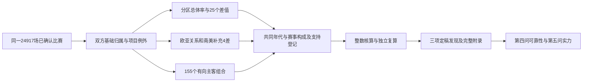

# 第三问结果审读、展示素材与后续接口

**第三问描述与材料准备已收尾（R20261027-05，2026-10-27）。** 当前regions-0a1c61664a722e6c641f保持不变。本文第9节为定稿发现与表述边界，第10节为90秒讲稿/流程，第11节为论文和HTML素材，第12节为实际验收，第13节为结束范围。[结论卡](../../outputs/logs/regions/final-handoff-20261027/conclusion_cards.json)、[展示资产](../../outputs/logs/regions/final-handoff-20261027/presentation_assets.json)和[验收记录](../../outputs/logs/regions/final-handoff-20261027/review.json)均已生成。原始完整29差/155组合保留，重点讲述案例不作为新的预注册检验族。第四问推断、第五问实力、最终HTML/论文及人员现场验收继续按既定安排后置。

2026-10-27，R20261027-03（数值延续R27-01，技术修正版）。当前regions-0a1c61664a722e6c641f，协议regions-study-v4。全部本节数字来自[本轮展示取数](../../outputs/logs/regions/closeout-20261027/regions-20261027T084412226301Z-f05899a3/display_data.json)、[组率](../../outputs/tables/regions/regions-0a1c61664a722e6c641f/group_summary.csv)、[预定差值](../../outputs/tables/regions/regions-0a1c61664a722e6c641f/contrast_results.csv)与[155个组合率](../../outputs/tables/regions/regions-0a1c61664a722e6c641f/matchup_rates.csv)；显示时四舍五入，原表保留精度。旧v3只作历史对照，完整列表见[两版计算范围对照](两版计算范围对照.md)。

## 1. 研究对象和必须交代的分类

1980—2024同一24,917场已确认非中立比赛，分组→整数胜平负→组率→共同年代×赛事构成→预定率差/主客组合→独立复算。26场主队归属未知，母样本没有被删改；五大洲已知主队24,891场：欧洲8,229、亚洲5,906、非洲5,868、美洲4,555、大洋洲333。关系字段未知只影响需要双方归属的目标，各目标去向均保留。

**论文与汇报必须单独说：土耳其在本研究计入欧洲，并归南欧。** [UEFA土耳其协会页](https://www.uefa.com/nationalassociations/tur/)记载土耳其足协1962年加入UEFA，支持其欧洲足球组织背景；“南欧”是组长明确选定的项目研究组，不是UEFA官方分区或联合国原始标签。同样，伊朗归西亚、澳大利亚归亚洲/东南亚是本项目例外，基础地理标签留在数据中。全期按同一规则处理双方，不是在复原历次足联归属，也不将其他欧足联成员自动改归欧洲。土耳其涉及184次主队、195次客队；伊朗157/153、澳大利亚169/146次，指角色出现次数，不相加为独立新增比赛。

非洲为北非、西非、其余撒哈拉以南三组，最后一组合并东非/中非/南部非洲；大洋洲只整体分析。球队ID及历史载体保留，217条日期规则、215个球队ID的完整原/研究分类见[分类登记](../../outputs/tables/regions/regions-0a1c61664a722e6c641f/study_team_registry.csv)。

## 2. 分区总体率：各组对所有对手

下面同一大洲内的分区使用同一个大洲参考；跨大洲使用不同参考，不能直接拼成世界排名。平局计入分母，按比赛等权，未控制实力。

### 欧洲四组

- 东欧：1,620场；直接51.3580%，共同构成调整后51.6077%。
- 南欧：2,402场；直接47.6270%，共同构成调整后47.6375%。
- 西欧：1,703场；直接50.5578%，共同构成调整后51.2270%。
- 北欧：2,504场；直接46.5256%，共同构成调整后46.5433%。

### 亚洲五组

- 东亚：996场；直接54.8193%，共同构成调整后54.8369%。
- 东南亚：1,386场；直接49.2785%，共同构成调整后48.8692%。
- 南亚：456场；直接39.6930%，共同构成调整后39.1123%。
- 中亚：326场；直接49.0798%，共同构成调整后不可估。
- 西亚：2,742场；直接47.0824%，共同构成调整后47.5185%。

### 非洲三组

- 北非：1,079场；直接63.9481%，共同构成调整后65.7312%。
- 西非：1,697场；直接56.0401%，共同构成调整后55.9730%。
- 其余撒哈拉以南：3,092场；直接46.4748%，共同构成调整后46.4201%。

### 美洲四组

- 南美洲：1,690场；直接57.1006%，共同构成调整后57.8533%。
- 中美洲：982场；直接57.1283%，共同构成调整后57.2939%。
- 北部美洲：590场；直接54.9153%，共同构成调整后56.3952%。
- 加勒比地区：1,293场；直接44.7022%，共同构成调整后43.6933%。

完整25个分区总体率差已输出：欧洲6、亚洲10、非洲3、美洲6。涉及中亚的4项全期调整差因1980年代友谊赛和非友谊赛均无比赛而不可估，其余21项可算。不是只挑胜率最高两组作比较。

## 3. 另外四项预定差值

- 欧洲主队：洲外减同分区：直接+13.6672个百分点；统一构成后+17.5044个百分点。
- 亚洲主队：洲外减同分区：直接-13.6160个百分点；统一构成后-14.6057个百分点。
- 南美主队：洲外减同分区：直接+18.7274个百分点；统一构成后不可估。
- 南美减美洲其他分区合并：直接+6.0360个百分点；统一构成后+7.0837个百分点。

欧亚地域关系分别在本地区关系可辨赛程内，以“跨大洲对手减同一研究分区对手”为预定差；同洲其他分区仍有背景率。南美减其余美洲是合并组补充差。南美主队2020—2024对洲外没有两类比赛，不能估全期调整关系差。总计29差中24可调整，5项不可估；直接29差全部可算。

## 4. 对手是谁：155格已逐格计算

- 大洲主队×大洲客队：5×5=25格，全部有比赛，11格具备完整调整支持。
- 洲内主队分区×客队分区：欧洲16、亚洲25、非洲9、美洲16，共66格，全部有比赛，51格具备完整调整支持。
- 主队分区×洲外客队大洲：16×4=64格，62格有比赛，9格具备完整调整支持。

全部155格保留；合计153格有比赛，71格可按原参考完整调整。两格完全无比赛：中亚主队对美洲、西非主队对大洋洲；其直接率也留空。其余部分组合虽然有总比赛，却缺正参考权重年代×类型层，只能给直接率，不能据此改参考或填0。矩阵每格都保留n、胜平负、参考、直接/调整状态和原因。

分区总体率差回答“这些地区主队各自所有赛程的表现差多少”；条件矩阵回答“指定主队分区遇到指定客队群体时表现怎样”。二者分母不同。东亚主对西亚与西亚主对东亚不能互补，跨洲客队只到洲，不再扩展到东亚对西欧这一级。未知客队不会被归到洲外。

## 5. 展示和论文取材

十组图见[当前图目录](../../outputs/figures/regions/regions-0a1c61664a722e6c641f)，均有PNG/SVG：五张主线概况图加五张主客矩阵图。矩阵包含全部预定格子；灰格与真实0%分开，不能把灰格解释成没有主场收益。展示JSON带同版输入/结果指纹，不能继续使用旧v3截图。

建议第三问讲述顺序：先用一句话说明球队归属与三项例外→用overview说明大洲背景→欧洲/亚洲/非洲/美洲各展示分区总体及完整比较，挑一张矩阵解释对手构成→结尾列出缺层、未控实力和第四问衔接。课堂总时长仍按课程规范分配，不将20个图文件全部塞进10分钟汇报。HTML页面及论文正文尚未制作，材料准备不等于最终交付。

论文方法应写清地理标准、项目例外、样本边界、直接率与共同构成公式、参考人群、不可估处理、全部目录及独立复核；不要将地域相关性写成因果效应。引用原始地理标准见[M49原件与出处](../../data/external/geography_sources/m49-20261026/README.md)，新增组织背景见[UEFA来源登记](../../data/external/geography_sources/study-overrides-20261027/sources.json)。资料原件去重没有删除引用信息。

## 6. 完成与未完成

描述代码及全部本轮清单已完成。160测试、8,116对账、1,369,336独立核查和34核心重跑一致支持计算实现正确；修正前v4和旧v3指纹核对通过，前两问未修改。它们不证明地理标签是唯一合理分类，也不是统计显著性检验或队友本人验收。

第四问仍要审定联合检验目标、方法及模拟验收，再分析比赛相关性、共同时间冲击、多比较、分类/参考/样本敏感性；第五问控制赛前实力。当前没有区间、p值、稳定性或因果结论。共同数据表和系数已交接，155个条件格不会自动当作155份独立证据。

## 7. 已完成的支持验收：零场、缺层与少量比赛分开登记

运行[support_audit.json](../../outputs/logs/regions/closeout-20261027/support/support_audit.json)已完成，明细[support_inventory.csv](../../outputs/logs/regions/closeout-20261027/support/support_inventory.csv)覆盖188个统计组，引用同版1,880条层计数和150条参考权重；脚本scripts/audit_region_support.py只清点，不估区间或检验稳定性。

- 零场：中亚主对美洲、西非主对大洋洲，没有直接/调整率；保留格子与原因。
- 总体率差缺层：中亚1980年代两类赛事无比赛，使涉及中亚4差无法全期调整；南美主队2020—2024没有洲外两类比赛，使其关系差无法全期调整。29差直接全可算、24可调整。
- 条件格缺层：155格153有场/71可调整；另外82格有比赛但缺正权重层，另2格零场。原参考不变，不用0补齐或借别组概率。
- 少量比赛：登记每组正参考层最少比赛数、只有1/2场的层数、最大已定义q/n，以及调整值减直接值。1/2场是事实提示，不是未经理论论证的通过/不通过门槛。
- 示例：中美洲主对南美洲125场，直接40.00%→调整61.1345%，十层中3层仅2场；东南亚主对美洲44场，直接40.9091%→56.5231%，2层只有1场。算法能计算这些值，不等于它们稳定可信。它们进入第四问检查清单，不作重点稳健结论。
- 未知归属：26场主队归属未知、99场双方关系未知，保留母样本与逐目标去向；不暗删第一/二问。

当前验收结果是目录、分母、支持和计算记录完整；不包括不确定性、分类敏感性或因果识别。

## 8. 与前两问及第四问的正式交接

第一问比较时间背景，第二问比较赛事背景，第三问比较地域与对手背景；三者使用相同24,917场母样本，重复利用同一比赛，不是三次独立验证，也不能将三个差值相加。前三问调整分别采用各自参考，第四问须保存这些定义并处理彼此关联。

第四问最新[任务说明](../../文档/05_团队协作/分工与交付/04_两题共同可靠性与敏感性.md)已登记：已知结果后的比较族选择、共享球队/主客互换与共同时间冲击、近期正差及36重叠窗、分类/参考/球队构成敏感性、稀疏层与不可估目标的不同处理。真实区间、模拟与敏感性尚未实施，先完成理论适配与验收协议再跑。

实力调整继续留第五问；当前没有测量地域造成的独立作用。正式HTML、论文正文、结论讲稿定稿及A/B本人复核继续后置，本轮仅完成用户选定的技术修正、支持清单及衔接。

## 9. 定稿核心发现：地域分组改变了我们怎样读胜率

本题的定稿主张是：**只报告“大洲平均主胜率”不足以描述样本；地区内部、比较对象以及双方地域关系都会改变观察到的结果。** 这说明比较必须定义清楚，没有证明地理因素的独立作用。

以下三项是看过结果后按解释价值选择的汇报重点，不是事前未见结果的确认性假设。所有16分区总体率、29差和155条件格继续完整保留；第四问最终检验族不能由这里的三张主图自动替代。

### Q3-F01：同一大洲内部不能只看一个平均数

同一非洲参考下，北非1,079场、西非1,697场、其余撒哈拉以南3,092场的调整主胜率分别65.73%、55.97%、46.42%；北非减其余为19.31个百分点。原来将撒哈拉以南整体看待，会遮住西非与其余组在当前档案中的差异。

证据为group_summary的C_AFR三组和contrast_results的C_AFR_015_VS_OTHER；共同参考是非洲5,868场的年代×赛事构成。主图[非洲分区展示图](../../outputs/figures/regions/presentation/regions-0a1c61664a722e6c641f/finding_01_africa.png)；完整精度/键/分母见[结论卡](../../outputs/logs/regions/final-handoff-20261027/conclusion_cards.json)。

允许说“同一大洲内部的主胜率并不一致，分区描述有必要”；不允许说“北非的纯主场优势最强”或“地理造成19.31个百分点”。地区内具体国家、对手、实力和赛程仍不同。

### Q3-F02：南美更高，要先说明在和谁比较

南美、中美、北部美洲、加勒比的调整率分别57.85%、57.29%、56.40%、43.69%。南美减其他美洲合并组为7.08个百分点，但南美减中美洲仅0.56个百分点。合并比较可以正确，却不能代替逐组比较，也不能改述为南美比所有其他分区都高出很多。

证据为C_AMER四组、C_AMER_FOCUS及C_AMER_005_VS_013；共同参考均是美洲4,555场的年代×赛事构成，前组减后组。主图[美洲四组展示图](../../outputs/figures/regions/presentation/regions-0a1c61664a722e6c641f/finding_02_americas.png)。其中合并组先按整数层场数/胜数合并再求率，不把几个分区率随意等权平均。

允许说“比较对象的选择会改变结论的读法”；不允许说“合并差已经解释了差异原因”，也不据小差认定南美与中美统计等同。

### Q3-F03：面对洲外对手，欧亚主队呈现相反方向

欧洲主队洲外1,484场与同分区1,838场的调整差为+17.50个百分点；亚洲分别1,743与1,934场，调整差为−14.61个百分点。各自参考包含关系可辨的三类赛程，欧洲8,175场、亚洲5,899场；同洲其他分区也已输出，不能抹去中间类。

证据为B_EUR/B_ASIA。主图[欧亚地域关系展示图](../../outputs/figures/regions/presentation/regions-0a1c61664a722e6c641f/finding_03_relations.png)。允许说“洲外关系与观察胜率的关联方向并不统一”；不允许说“跨洲旅行使欧洲受益、使亚洲受损”。本题没有测量真实旅行距离，也没有统一双方实力；正反主客不是同一批匹配比赛，不能相加为一个概率。

### 补充与不能估的结果怎样处理

欧洲四组/六差、亚洲五组/十差、非洲三组/三差、美洲四组/六差及全部主客矩阵作为附录保留。东欧与西欧调整率差约0.38个百分点只能称点估计接近；东亚减南亚约15.72个百分点仍是未控实力的描述。中亚不能加入全时期调整排名，南美洲外关系无完整调整差。

155格中2格零场、82格有场但缺正权重层、71格可完整调整；“可算”不是“可靠”。例如中美主对南美的125场中3层只有2场，调整变化较大，必须交第四问而不能作为稳健发现宣传。表述中禁用当前尚无依据的“显著”“稳定证明”“因果贡献”和“预测已提升”。

### 本题在整个项目中的作用

本题已经提供比较对象、地理标签和数据支持边界，说明粗平均可能遮蔽不同赛程的表现。第四问再检验结论对样本/参考/分类和依赖结构有多敏感；第五问才问考虑赛前实力后还有多少主场信号；第九问再检验背景信息是否带来样本外预测增量。后三者都是待完成研究，本题既不借未来成果为自己背书，也不因尚未完成预测而否定已有描述。

## 10. 已定稿的讲述顺序、短讲稿与工作流程

### 主讲三屏，建议约90秒

这是第三问描述模块的内容预算，最终必须服从全组10分钟安排；没有进行真人计时或排练，不与前两问旧建议时长机械相加。

**第一屏，约25秒，Q3-F01。**

“第三问比较不同地域背景下的主队表现。我们发现，一个大洲内部也不能只看平均数。统一年代和赛事比例后，北非、西非、其余撒哈拉以南的主胜率约为66%、56%、46%。所以分区有描述价值，但这还不是地域造成的主场优势。”

**第二屏，约30秒，Q3-F02。**

“还要问在和谁比。南美高于其他美洲合并组约7个百分点，但与中美洲只差约半个百分点。把其他分区合起来，与逐个分区比较，会给人不同印象。我们保留完整四组，避免把合并结论说成对每个地区都成立。”

**第三屏，约25秒，Q3-F03。**

“对手也重要。面对洲外而非同分区对手，欧洲主队的调整差约为正17.5个百分点，亚洲约为负14.6。方向相反，但双方实力还没统一，因此不能解释成旅行造成的效果。接下来要检查结果可靠性，再考虑赛前实力。”

**过渡，约10秒。**

“前三问共同提醒我们，观察到的主胜率需要放回时间、赛事和对手背景中理解。第四问检验这些描述能讲多强，第五问再区分实力与主场信号。”

主屏数字可以口头适度舍入；图和结论卡保留两位小数，表内不先舍入。三屏均提供原始/调整对照，不能把共同参考调整率当成档案中直接数出的新比赛比例。

### 工作流程展示素材

以下是可直接用于后续页面的静态流程说明；本轮没有制作最终HTML页面：

### 图注和页面取数要求

三张展示专图均1920×1080，另有SVG；主胜率轴0—100%，差值轴过零且单位为百分点，无误差线。每张图保留时间范围、非中立/平局/点球口径、未控实力/无区间及三项分类例外。后续页面应从presentation_assets.json和conclusion_cards.json取数，保留source_run和SHA引用，不从研究日志手抄。

全文与答辩附录保留完整10组主分析图、29差/155格、来源与字典。空值显示“无比赛”或“缺层不可估”，不能转换成0。若增加交互，只切换同版已验证数据，不改变正式研究配置，不现场重新训练或联网取新数据。

## 11. 论文与HTML材料已经整理到哪里

- 结论原子数据与允许/禁止表述：[conclusion_cards.json](../../outputs/logs/regions/final-handoff-20261027/conclusion_cards.json)。每个数字有源表、行键、列、单位、分母和参考。
- 页面制作者的资产清单：[presentation_assets.json](../../outputs/logs/regions/final-handoff-20261027/presentation_assets.json)，含三张主讲图PNG/SVG及完整主分析图附录路径。三张新图是同版结果的展示派生产物，不改变原34核心文件。
- 实际材料验收：[review.json](../../outputs/logs/regions/final-handoff-20261027/review.json)；构建过程[build_handoff.py](../../outputs/logs/regions/final-handoff-20261027/build_handoff.py)保存来源和生成方式，正常读者不用再执行。材料更新须新建版本，不覆盖此验收或原研究文件。
- 论文Method：阶段README的数学/分类说明、脚本设计、config、球队登记、数据字典及原始来源；Results：group_summary、contrast_results、matchup_rates及本节三项结论；Discussion：本题解释边界、支持清单、第四问交接及第五/九问尚待检验的问题；References：方法文献与地理来源登记。
- 完整文件名/路径统一在[论文与汇报支撑材料索引](../../文档/05_团队协作/论文与汇报支撑材料索引.md)登记，只索引、不搬材料。

HTML主页面许可、离线/投影/交互与全组三人排练按课程规范在最终整合时验证；本轮素材完成不等于页面、论文正文或成员验收已经交付。

## 12. 实际验收与本题完成判断

[本次验收记录](../../outputs/logs/regions/final-handoff-20261027/review.json)确认：

1. 现有运行84项输入/源码/核心产物/运行附件指纹匹配，主分析代码与数字未改；既有160测试、8,116对账和1,369,336独立核查记录继续保留。本轮仅材料修改，不重复跑全套pytest或主分析。
2. 从整数比分汇总层与参考分数独立重建188组率及29差，结合样本和产物核对，共3,335项检查通过；155个应有方向组合逐一匹配、无漏/重。
3. 第一问22份、第二问23份登记产物仍匹配，三问纳入比赛ID集合完全相同，均24,917场；主队未知的局部处理没有偷偷改变前两问。
4. 三张新展示图实际查看，中文、字号、范围、图例、数值和边界提示正常；现有主分析图的查看记录与当前SHA一并保留。没有声称教室投影、浏览器交互或成员本人已验收。
5. 定稿陈述和每个数字逐键绑定；同版结论卡、主图、完整附录、样本/分组来源、支持清单和第四问接口均可定位。没有将重点展示案例当作独立证据或新的预注册检验族。
6. 阶段README、总README、pipeline、材料索引、团队交接与研究日志同步当前阶段结束范围；所有最终链接与新增产物指纹在交付前再次检查。

这完成第三问描述计算、结论定稿、材料准备和技术交接的全部约定收尾，不表示整个课程项目所有交付都结束。

## 13. 已关闭的工作与明确后置事项

八步推进中的研究清单、分组准备、场数/参考支持、直接统计、共同构成调整、独立核算、结论/材料、后续交接均已完成；本轮五项收尾中的技术修正、核心发现、支持登记、第四问交接、论文/展示素材准备全部关闭。

按用户此前决定，第四问的正式方法/模拟/不确定性和敏感性、第五问实力调整、最终HTML与论文正文、A/B本人复现/审读、全组排练和老师载体确认继续后置，并分别由相应阶段或最终交付负责。它们不是本题被漏掉的描述计算，也不得填成已经完成。A/B要求已写清，可以结束第三问并进入第四问方法讨论，无需为收尾继续增加地域类别。
