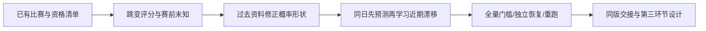

# 第二环节：完整验收、模型迭代与正式交接

**第五问第二环节的最终采用管线已通过本阶段全部必要检查，可以进入第三环节。** 当前方法是“完整跳变评分＋过去资料的概率形状校正＋动态残差校正”。原24,917场全部保留，原始数据、117场采纳和前三问结果均未改动。

本页更新于2026-10-30，承接R20261029-12至20，正式采用见R20261030-01。这里的“全部通过”指最终管线的预设工程与模型条件检查；旧失败候选如实保留。所有历史已经复用，新成绩是开发回放，不是新增独立未来检验。A/B本人复核、最终论文和HTML尚未完成。

## 1. 最后采用了什么，为什么

底层评分保留双方共同学习、中立学习、平局、连续变化、持续跳变及完整协方差。每天先形成全部预测，再联合学习当天结果。没有比赛时评分中心不直接改变，不确定性可以增加。

最后选择完整跳变版本，参数为q=.03、跳变率.08/年、跳变尺度1.2、平局阈值.4、友谊赛学习系数.65、背景比例.05、共享场地扩散.005/年。评分不是FIFA或Elo积分，采用固定表现噪声单位。

概率层分工明确：

1. **形状校正。** 每年只用此前十年的已有赛前概率和赛果，拟合受正则的共同温度与两个截距，分别处理赛事/中立语境；稀疏时按已冻结规则回退父组。
2. **动态残差。** 在形状已经修好的概率上，跟踪近期还有没有持续高估/低估。两个截距按零漂移过程演化，扩散.02/年，用二维积分先预测、再联合学习同日结果。

此前把这两种方法当作替代项混合，没能同时得到两者的优点；串联后两项职责同时保留。新校正没有改写潜在实力，也没有按某个失败年份单独加常数。

组合开发固定比较两种形状、四种漂移，共8候选。只有两种.02方案全过；共同温度方案全期损失.8909487480，二维矩阵方案.8912580894。按事前“先全部合格，再比较损失和简单性”采用前者。它不是全世界所有算法中已被证明的最优方案；平稳场景中更简单评分有更小误差，这项代价仍保留。

## 2. 哪些门槛通过了

**样本与时序：** 38,919场条件性学习比赛、24,917场研究比赛全部对账，ID唯一，当前赛果不进入当场评分或校正。32个日期出现同队多次比赛，按共享球队块处理；最大的关联块4场，不把同一球队跳变量重复算几次。

**程序性质：** 当前63项针对性测试通过，包括双边学习、中立、平局、非零跳变的主客镜像、同日输入顺序和结果无泄漏、协方差、保存恢复、校正梯度及续算。

**数值与独立参照：** 新跳变12项小维次数积分/Gauss-Hermite参照通过原1个百分点线；全量普通/严格跳变最大概率差约6.885e-7。完整管线收紧积分与评分数值后，最大概率差约4.777e-7，远小于原.01线。底层622,874项独立核对、完整管线389,393项独立核对通过；核对数不是独立比赛数。

**完整预测：** 1980—1999、2000—2009、2010—2019、2020—2024以及原1980—2009、2020—2022、2023—2024均保留。每段分别检查全部学习比赛和原研究比赛，另检查两类赛事，共28组结果检查。普通和严格两套均通过原要求：

- 相对历史频率的对数损失改善至少.005；准确率至多落后频率1个百分点。
- 至少200场的概率格误差不超过10个百分点；平均主胜概率偏差不超过3个百分点。
- 对数损失至多落后固定步长基准.01；足量赛事分组的偏差和概率格也检查，不再只看总体。

**模拟：** 本轮96次压力模拟和16次未匹配参数模拟已经运行。选定完整跳变在原四情景的工程覆盖/MSE要求和新两种参数世界中均通过。新参数(.03,.7)/(.12,1.0)下，标称90%评分差范围覆盖约95.90%/92.65%。这支持有限工作范围，不是现实足球无条件覆盖定理。

**重跑与恢复：** 底层使用归档源码完整重放，4份核心数值产物字节一致；最终校正/接口完整重跑，8个核心文件及清单一致。1979、2019检查点续算包含底层评分、形状校正和动态残差；不再只检查文件存在。2024最新底层状态另外保存，严格版明确仅作精度对照，不指向普通版恢复状态。

## 3. 此前卡住的地方现在怎样了

2020—2022友谊赛415场，在早期修正方案中主胜仍低估约3.32%—4.51个百分点。当前为**低估2.3913个百分点**，进入3个百分点线；同期正式赛低估约0.7689个百分点。

2023—2024友谊赛主胜高估约0.9619个百分点，正式赛约0.3622个百分点，也通过原线。完整概率损失及基准比较同时通过，没有只追求这一项偏差变小。

这些数字不能直接当作赛事效应：它们是预测残差检查，回答预测有没有系统偏离，尚未回答计入实力后的赛事差异有多少。后者属于第三环节。

## 4. 跳变为什么终于可算且通过了数值检查

旧方法同时展开所有球队跳变组合，遇到内存增长；后来先把次数压成均值再合并，仍有约1.328个百分点的近似差。因此本轮没有把旧结果改成通过，而是更换计算顺序。

新方法先积分掉当前Poisson次数，再处理赛果：不共享球队的单场可解析折叠；共享球队的几场组成因子块，使用同一个跳变量。各块仍通过旧评分和场地协方差联系，不把球队当独立。日末才重建完整均值/协方差并作高斯投影。

设旧表现u为正态，双方位移均值0、条件方差为次数乘tau²，则在总次数N=n时，表现方差增加n·tau²。总次数服从Poisson，单场证据是相应正态赛果证据的加权和。给定总数后，两队次数按Binomial分配，可以计算双方位移与旧表现的联合矩，保留双边信息。

共享块使用局部次数枚举和EP；次数尾部受明确容差控制，再用更严设置和独立积分核对。有限背景概率给局部证据正下界，可检查局部截断影响；不能把这种局部界直接声称为整段历史的无条件总误差界。

跨日高斯投影仍会丢失部分多峰信息，EP也不总有普遍收敛保证。当前结论限于已核验范围。合并/投影后的状态不能输出“已经精确识别某国哪一天真实突变”的断言。

## 5. 迭代记录怎样追踪

完整理由和实际失败在研究日志R20261029-12至20，主要结果入口如下，全部保留：

- 原v1/v2/v3及R11：旧全量概率偏差失败、旧检查点错误及有限探索放行，见[历史停止点](自主推进_停止交接与下一步.md)。
- 校正v5：[c9f33a1708a15016cf7b](../../outputs/logs/strength/repaired-calibration-c9f33a1708a15016cf7b/report.json)，友谊赛短段失败。
- 分语境v6：[7b111a3f06958c26a954](../../outputs/logs/strength/repaired-calibration-7b111a3f06958c26a954/report.json)，同项未解决。
- 动态候选v7：[a06a972c24e7812844b1](../../outputs/logs/strength/repaired-calibration-a06a972c24e7812844b1/report.json)，选择规则仍未修好该项。
- 切换混合v8：[5f9e18f153e27f6fd366](../../outputs/logs/strength/repaired-calibration-5f9e18f153e27f6fd366/report.json)；矩阵v9：[b99cfacb6b54d31e5638](../../outputs/logs/strength/repaired-calibration-b99cfacb6b54d31e5638/report.json)。均保留失败。
- 完整核心v10：[517931071c3c591d4e40](../../outputs/logs/strength/repaired-calibration-517931071c3c591d4e40/report.json)；信息成分v11：[8294eaabeed6eb9b98f1](../../outputs/logs/strength/repaired-calibration-8294eaabeed6eb9b98f1/report.json)。仍未过，未采用。
- [快速校正诊断](../../outputs/logs/strength/fast-calibration-diagnosis-48e039e298b5d20270a8/report.json)：均值改善但损失失败，未采用。
- [形状—漂移组合](../../outputs/logs/strength/composed-calibration-8176105d420b3f2400eb/report.json)：8候选全部报告，两种.02通过；最终选择温度方案。

这是多次复用历史的开发选择过程。不能删除前面失败后，把最后的历史成绩包装成一次盲测成功。

## 6. 初始化与没有被“通过”消除的限制

新跳变核心已完整重算1960起点及初始方差.5/2，各保留24,917场；旧R11高斯敏感性仅作历史。平均原概率变化约.0606/.4571/.4372个百分点，仍有少数明显敏感场次，最大约6.61/28.64/19.28个百分点。敏感性验收要求覆盖、定位和留痕，不要求缺乏历史的球队凭空得到唯一不变的点估计。

新准备表有2,905场初始化原概率变化超过1个百分点，保留范围和标记。它不是置信区间，不是最终校准概率变化的直接测量，也不能作为默默删比赛的理由。冷启动359场、此前累计图不连通80场仍明确标注；累计连通不保证跨区标尺已充分可靠。

学习范围仍为条件性资格包，4,719场待定扩展未进入学习，原117场采纳不重开。评分后验只覆盖所用规则下的部分未知，没有包含全部身份、模型选择和现实失配。对真实未来的独立检验尚未运行，后续第八问再做；这不改写本轮工程验收状态。

## 7. 当前采用文件与第三环节接口

最终普通版：[strength-delivery-ca43fe498cd43ec8e21f](../../data/processed/strength/strength-delivery-ca43fe498cd43ec8e21f/report.json)。严格版：[strength-delivery-e67aeee4c7462a00cf50](../../data/processed/strength/strength-delivery-e67aeee4c7462a00cf50/report.json)，只作精度核对。

每版有全部及研究赛前表、报告、检查点、形状状态、字典、源码快照和manifest。正式采用和同版关联表为[adoption.json](../../data/processed/strength/joint-preparation-6fa9d025ba40d11cd2f8/adoption.json)、[analysis_matches.csv](../../data/processed/strength/joint-preparation-6fa9d025ba40d11cd2f8/analysis_matches.csv)、[接口字典](../../data/processed/strength/joint-preparation-6fa9d025ba40d11cd2f8/data_dictionary.md)。测试XML和所有采用证明已复制在该不可变准备包内；旧joint-input-0812683da0560b0b687b不再作新评分的联合入口。

新接口特别提供基础差值方差、双方Poisson强度和尺度。总方差只是二阶摘要；下一环节必须保留混合积分。最终p_*和主场项用于评分检查，不作为新的独立解释因素加入联合模型。

## 8. 本人和队友A怎样运行

先按仓库环境指南配置，在仓库根目录运行，PyCharm使用模块名src.strength.delivery，不能直接把.py文件当独立脚本运行：

~~~powershell
$env:OPENBLAS_NUM_THREADS='1'
$env:OMP_NUM_THREADS='1'
python -m src.strength.delivery
python -m src.strength.delivery --strict
python scripts/audit_final_strength_delivery.py
python scripts/repeat_strength_delivery.py
~~~

这四步使用仓库已登记的底层评分，重算校正、接口、独立审计和前端重复证明。若要核验底层确实从头重跑，执行：

~~~powershell
python scripts/replay_archived_jump.py data/processed/strength/jump-ratings-451ecade0bf84ee0bfb6
~~~

它使用已归档的实际评分源码重放全部学习比赛，检查4核心产物，不会用后来修改的校准模块冒充旧执行版本。重新开发全新评分可用scripts/repair_strength_jump.py；新输入路径和检查点须一起重新绑定，不能只换一个目录。

不同提交/依赖/平台可能改变版本ID。A需报告自己的环境、输入/源码身份、运行退出状态与数值比较；字节差异要说明原因，不可直接改成通过。当前63测试见tests/test_strength*.py；A本人复现尚待执行，不将AI核算写成真人复核。

## 9. 材料怎样进入论文和汇报

可讲清楚的工作链是：原概率偏差失败→区分形状与近期漂移→局部/开发/全球迭代→完整恢复和重复验证→同版评分交接。论文方法记录完整的候选及负结果，不能只留下最后一版。

展示的核心不是“模型变复杂所以更好”，而是：持续变化需要专门处理；概率形状和近期偏移需要各自负责；每次改动都必须经完整门槛检查。最终HTML/论文正文尚未制作，实际[展示取数](../../outputs/logs/strength/strength-final-display-8e78ec65a9376c23e2c1/display_data.json)和材料路径登记在统一索引。

下一环节见[共同分析思路与Python脚本设计](第三环节_联合分析准备与接口.md)：R30-01交接时只完成设计；R30-03至05已实现并运行点估计，当前见[第三环节结果与交接](第三环节_运行结果与交接.md)，统计区间另行验收。

